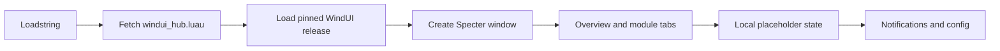
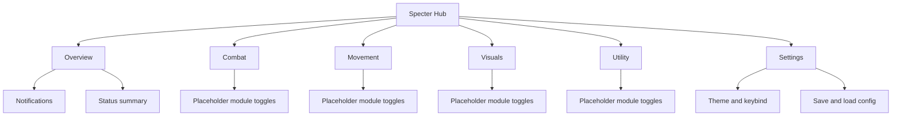
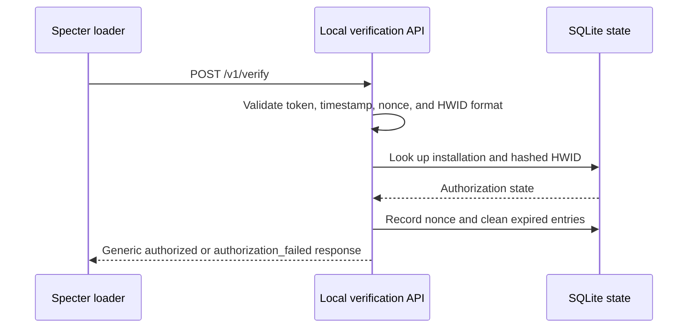

# Specter.boot

Specter.boot is a Roblox Luau interface shell built with [WindUI](https://github.com/Footagesus/WindUI). It gives Specter a clean dashboard, module tabs, settings, notifications, theme controls, and local configuration support.

> **Current behavior:** the module switches are safe UI placeholders. They update local state and show feedback, but they do not automate gameplay, inject code, or execute remote game actions.

## Quick start

Run this loadstring in a Roblox environment that supports `loadstring` and `game:HttpGet`:

```lua
loadstring(game:HttpGet(
    "https://raw.githubusercontent.com/0craxy0/Specter.boot/master/roblox-client/windui_hub.luau"
))()
```

The hub loads WindUI release `1.6.66`, creates the Specter interface, and opens the safe preview catalog. Press `RightShift` to toggle the window.

## How it works



The client is split into small parts:

| File | Purpose |
| --- | --- |
| `roblox-client/windui_hub.luau` | Main WindUI interface and event wiring |
| `roblox-client/catalog.luau` | Typed-ish Specter module metadata |
| `roblox-client/loader.luau` | Legacy custom interface implementation |
| `roblox-client/validate_hub.ps1` | Static Luau validation and safety checks |
| `backend-server/server.js` | Local verification service for installations |
| `plan.md` | Verification and payload architecture notes |

## Interface map



## Verification service network flow

The optional backend is designed as a local companion service. It binds to `127.0.0.1` by default and exposes `POST /v1/verify`.



The service uses short-lived signed tokens, timestamp checks, nonce replay protection, rate limiting, HMAC-derived HWID hashes, constant-time comparisons, and generic authorization errors. Secrets must remain server-side.

## WindUI customization

The hub uses a custom `Specter Midnight` theme with a violet accent:

```lua
WindUI:AddTheme({
    Name = "Specter Midnight",
    Accent = Color3.fromHex("#8B5CF6"),
    Background = Color3.fromHex("#0B0A12"),
    Outline = Color3.fromHex("#302A46"),
    Text = Color3.fromHex("#F5F3FF"),
    Placeholder = Color3.fromHex("#918BA8"),
    Button = Color3.fromHex("#201A32"),
    Icon = Color3.fromHex("#C4B5FD"),
})
```

The main hub accepts optional settings when embedded by another loader:

```lua
local Hub = require(path.to.windui_hub)

local specter = Hub.new({
    Title = "Specter // Script Hub",
    Theme = "Specter Midnight",
    OnToggle = function(item, enabled)
        print(item.Name, enabled)
    end,
})
```

## Local validation

From the repository root, run:

```powershell
.\roblox-client\validate_hub.ps1
node --check .\backend-server\server.js
```

The validator checks Luau file discovery, balanced delimiters, required WindUI symbols, and a small set of destructive or network-action patterns.

## Project status

- WindUI release: `1.6.66`
- Default toggle key: `RightShift`
- Default backend bind: `127.0.0.1:8443`
- Module behavior: safe placeholder mode
- Primary branch: `master`

## License and responsible use

Use Specter only in environments where you have permission to run custom scripts and verification services. Review every module callback before attaching real behavior, and never place signing secrets, peppers, or private credentials in client-side Luau.
